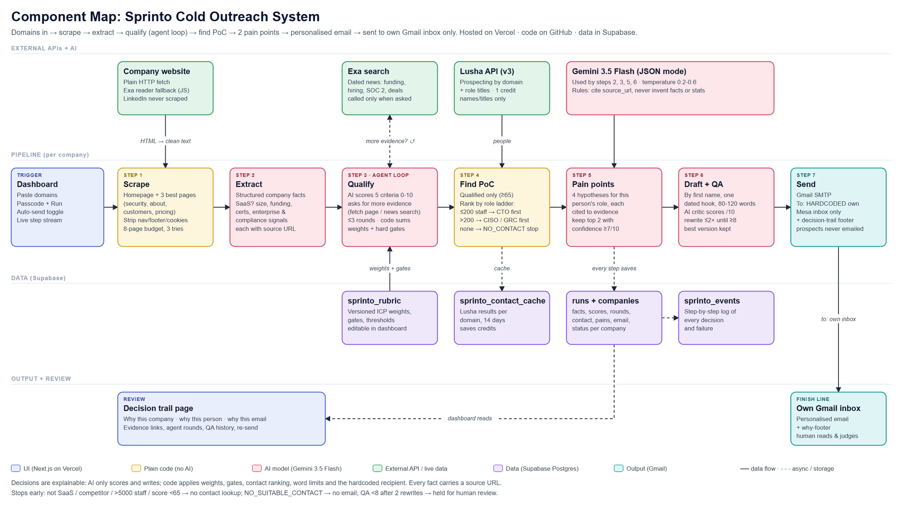

# Sprinto Outreach: AI Case 2

An automated cold-outreach system for Sprinto, which automates SOC 2, ISO 27001 and GDPR compliance. You give it company domains. It reads each website, decides whether the company fits Sprinto's ideal customer (running an agent loop to fetch more evidence when needed), finds the right person, picks two likely pain points, writes a personalised email and sends it to **my own inbox only**.

**Live:** https://sprinto-outreach-woad.vercel.app · **Component map:** [`public/component-map.png`](public/component-map.png) (also at `/architecture` in the app)



## The 7 steps

| # | Step | Who decides | How |
|---|------|-------------|-----|
| 1 | Scrape | Code | Plain HTTP fetch of the homepage plus the 3 most useful pages (security/trust, about, customers, pricing). Cheerio strips nav, footer, cookie and banner text. If a page is blocked or built by JavaScript, the Exa reader is the fallback. Budget: 8 pages per company. LinkedIn is never scraped. |
| 2 | Extract | Gemini 3.5 Flash | Structured facts in JSON: SaaS or not, size, funding, certifications, enterprise, compliance and data signals. Every fact carries a source URL and a short quote. |
| 3 | Qualify (agent loop) | Gemini scores, code decides | The AI scores 5 weighted criteria from 0 to 10 and can ask for more evidence (`fetch_page`, `search_news`, `search_web` via Exa). Max 3 rounds. Code adds up the weighted points (pass mark 65/100) and applies hard gates: must be SaaS, not a competitor, ≤5000 staff, and compliance trigger ≥5/10 (an already-certified company with no reason to buy now is skipped). If a heavy criterion rests on low-confidence evidence, code forces one more look. |
| 4 | Find the contact | Lusha API + code | Lusha v3 prospecting search by domain and role titles. It returns names and titles only, with no email reveal. Results are cached for 14 days. A fixed ladder ranks people: at ≤200 staff the CTO or a technical founder comes first; above 200, a CISO, Head of Security or GRC lead. If nobody fits, the result is `NO_SUITABLE_CONTACT` and no email is sent. |
| 5 | Pain points | Gemini | Writes 4 role-specific hypotheses, each cited to evidence. Keeps the top 2 with confidence ≥7/10. |
| 6 | Draft + QA | Gemini writer + Gemini critic + code | Addressed by first name, with one dated hook taken from the evidence, 80-120 words (code counts) and one call to action. The critic scores it out of 10, the draft is rewritten up to 2 times, and the best version is kept. |
| 7 | Send | Code | Gmail API (OAuth refresh token saved through the `gws` CLI); Gmail SMTP with an app password as the fallback. **The recipient is hardcoded to `OUTREACH_TO` (my own inbox).** The email ends with a footer explaining why this company, why this person, the pain points and the hook source. |

Every step writes to Supabase (`sprinto_runs`, `sprinto_companies`, `sprinto_events`). The rubric lives in `sprinto_rubric`, is versioned, and can be edited on the `/rubric` page.

## ICP definition

A B2B SaaS company at Series A-C (about 20-1000 staff) that sells to mid-market or enterprise buyers, shows a compliance trigger, and handles sensitive data. Compliance triggers include a fresh funding round, SOC 2 in progress, a trust page with gaps in its frameworks, security hiring, regulated customers, or EU/US expansion.
Weights: SaaS 20 · stage 20 · enterprise motion 20 · compliance trigger 25 · sensitive data 15.

## Run locally

```bash
npm install
cp .env.example .env.local   # fill in keys
npm run dev
```

Run `supabase/schema.sql` once against your Postgres database.

## Env

`SUPABASE_URL`, `SUPABASE_SECRET_KEY`, `GEMINI_API_KEY`, `GEMINI_MODEL`, `EXA_API_KEY`, `LUSHA_API_KEY`, `OUTREACH_TO` (your own inbox), `GMAIL_USER`, and Gmail auth: either `GMAIL_CLIENT_ID` + `GMAIL_CLIENT_SECRET` + `GMAIL_REFRESH_TOKEN` (from `gws auth login -s gmail` then `gws auth export`) or `GMAIL_APP_PASSWORD`, `RUN_PASSCODE`, `SENDER_NAME`, `APP_URL`.
